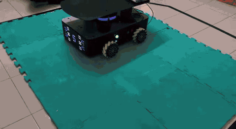
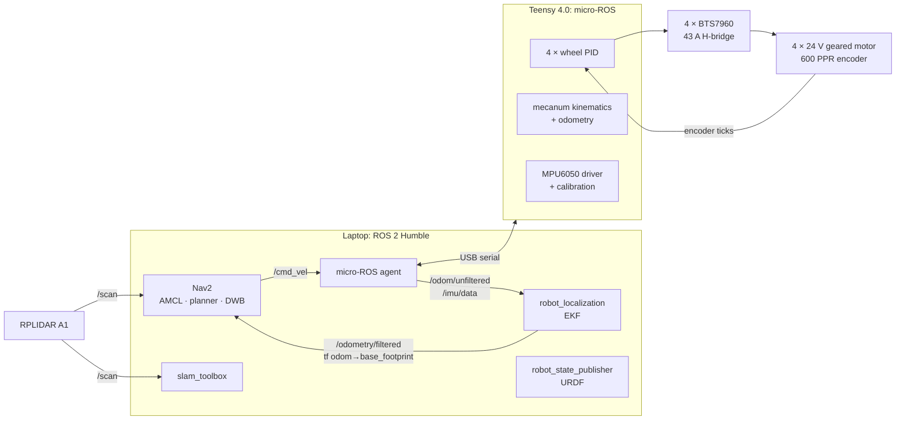
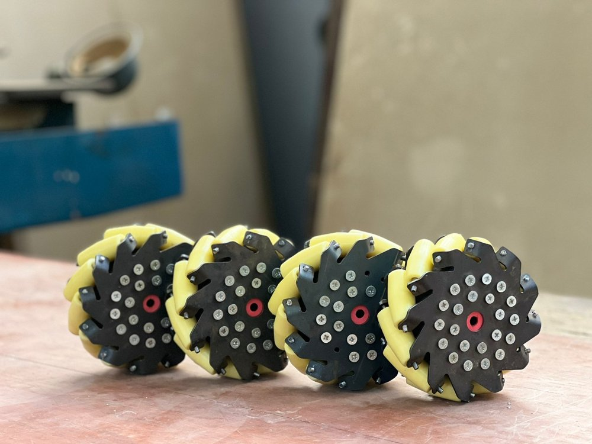
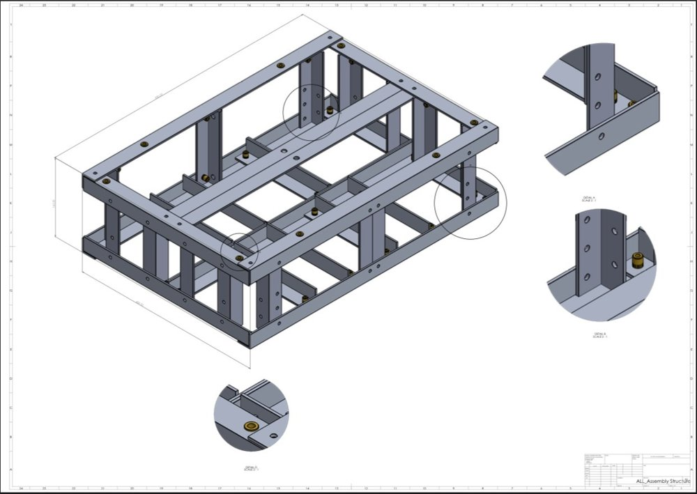
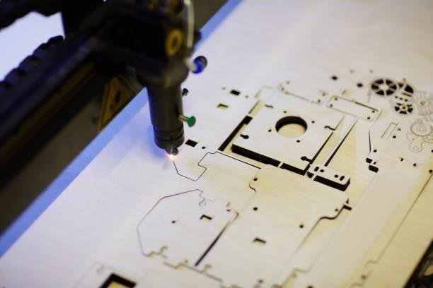
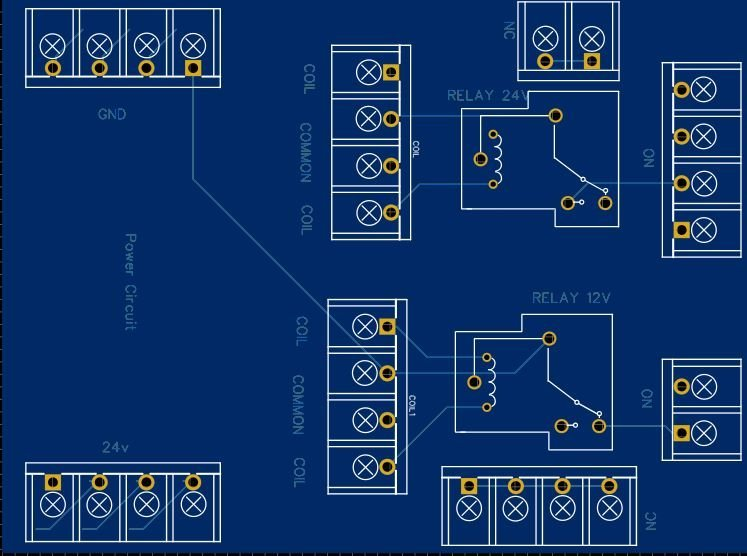
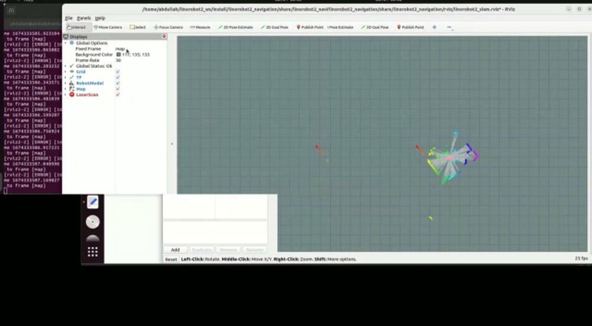

# Autonomous Mobile Robot (ROS 2, mecanum wheels)

General-purpose autonomous mobile robot for intralogistics: omnidirectional mecanum base, LiDAR SLAM and autonomous navigation on ROS 2, and a Teensy 4.0 that runs motor control and odometry over micro-ROS.

B.Sc. graduation project, Mechatronics Engineering, Mansoura University (2022/2023). **Graded 1.0.** Built by a 12-person team led by Mohamed Sroor, supervised by Prof. Dr. Mahmoud Saafan.



> **About this code.** The original source was lost after graduation. This repository is a **2026 reconstruction** from the project handbook (wiring, components, design) and the demo video (software stack). The architecture is the one we ran on the robot: a Teensy over micro-ROS, slam_toolbox and Nav2 on ROS 2, following the open-source [linorobot2](https://github.com/linorobot/linorobot2) reference design. The code is new and written from scratch. It has not run on the physical robot, which no longer exists. The kinematics and odometry are unit-tested and the ROS 2 packages are built in CI.

## What the robot does

- **Maps** an unknown room with a 360° LiDAR (slam_toolbox, 5 cm grid).
- **Localises** itself on a saved map (AMCL with an omnidirectional motion model).
- **Plans and drives** to goals set in RViz (Nav2: NavFn global planner, DWB local planner with sideways velocities enabled).
- **Moves in any direction** without turning first, thanks to four mecanum wheels.
- **Stops safely**: the firmware halts the motors when `/cmd_vel` goes quiet for 400 ms or the PC link drops, and a hardware emergency stop cuts the actuators.

## System overview



## Hardware

| Part | Model | Role |
| --- | --- | --- |
| Microcontroller | Teensy 4.0 (ARM Cortex-M7, 600 MHz) | Real-time motor control, odometry, IMU, micro-ROS client |
| LiDAR | Slamtec RPLIDAR A1 | 360° scan, 12 m range, ~5.5 Hz |
| IMU | MPU6050 (6-axis) | Gyro and accelerometer for the EKF |
| Motor drivers | 4 × BTS7960 (IBT_2), 43 A | One PWM pin per direction, thermal and over-current protection |
| Motors | 4 × DC geared motor, 24 V, 55 rpm, 54 kg·cm | Wheel drive |
| Encoders | YT06-OP quadrature, 600 PPR | Wheel speed feedback (2400 counts/rev with ×4 decoding) |
| Wheels | Custom mecanum, 12 rollers at 45°, R = 98 mm | Omnidirectional motion |
| Power | 12 V battery, 12 V 40 A charger, XL4015 buck converters | Drive and logic power |
| Safety | Emergency stop button, status LEDs, voltmeter | Cut actuators, show state and battery level |

Pin assignments are in [`firmware/amr_base_teensy/config.h`](firmware/amr_base_teensy/config.h). Motor 1 follows the wiring diagram in the handbook; the other three use the same pattern.

## Repository layout

```
firmware/
  amr_base_teensy/      Teensy sketch: micro-ROS node, PID, kinematics, odometry, MPU6050
  test/                 Host-side unit tests for kinematics and odometry (run in CI)
ros2/src/
  amr_description/      URDF (xacro) of the robot, RViz config
  amr_bringup/          micro-ROS agent, RPLIDAR, robot model, EKF (robot_localization)
  amr_navigation/       slam_toolbox mapping, Nav2 navigation, parameters, maps
docs/images/            Photos, CAD and the demo GIF
```

## Running it

**1. Flash the Teensy.** Install Teensyduino and [micro_ros_arduino](https://github.com/micro-ROS/micro_ros_arduino) (Humble), open `firmware/amr_base_teensy/amr_base_teensy.ino` and upload. Keep the robot still for one second after power-up while the IMU calibrates.

**2. Build the workspace** on Ubuntu 22.04 with ROS 2 Humble:

```bash
sudo apt install ros-humble-slam-toolbox ros-humble-navigation2 ros-humble-nav2-bringup \
                 ros-humble-robot-localization ros-humble-rplidar-ros ros-humble-xacro \
                 ros-humble-teleop-twist-keyboard
# micro-ROS agent: see https://github.com/micro-ROS/micro_ros_setup
cd ros2 && colcon build && source install/setup.bash
```

**3. Map a room** by driving with the keyboard (hold Shift to strafe), then save the map:

```bash
ros2 launch amr_navigation slam.launch.py
ros2 run teleop_twist_keyboard teleop_twist_keyboard
ros2 run nav2_map_server map_saver_cli -f ~/maps/lab
```

**4. Navigate** on the saved map. In RViz, set the start with *2D Pose Estimate*, then send a *Nav2 Goal*:

```bash
ros2 launch amr_navigation navigation.launch.py map:=$HOME/maps/lab.yaml
```

**Tests** (no ROS needed):

```bash
g++ -std=c++11 -Ifirmware/amr_base_teensy firmware/test/test_kinematics.cpp -o test_base && ./test_base
```

## Mecanum kinematics

With wheel radius *r* and lever arm *l = (L<sub>x</sub> + L<sub>y</sub>) / 2*, a body velocity (v<sub>x</sub>, v<sub>y</sub>, ω) maps to wheel speeds:

```
ω_FL = (v_x − v_y − l·ω) / r        ω_FR = (v_x + v_y + l·ω) / r
ω_RL = (v_x + v_y − l·ω) / r        ω_RR = (v_x − v_y + l·ω) / r
```

The firmware runs this inverse model for the PID setpoints and the forward model on the measured wheel speeds for odometry. If one wheel would exceed 55 rpm, all four are scaled together so the robot keeps its heading. See [`kinematics.h`](firmware/amr_base_teensy/kinematics.h).

## Mechanical design

Designed in SolidWorks. The chassis frame is aluminium profile, the inner plates are laser-cut MDF (5 mm for the chassis, 3.4 mm elsewhere), and the outer body is 3D printed. We designed and built the mecanum wheels ourselves.

| Mecanum wheels | Chassis (CAD) |
| --- | --- |
|  |  |
| **Laser cutting the plates** | **Power PCB layout** |
|  |  |



## Credits

- Architecture and wiring follow [linorobot2](https://github.com/linorobot/linorobot2) (Apache 2.0) by Juan Miguel Jimeno, which the team used on the robot. This rebuild does not copy its code.
- Mansoura University, Faculty of Engineering, Mechatronics Program. Supervisors: Prof. Dr. Mahmoud Mahmoud Saafan, Eng. Ahmed Ramadan, Eng. Alaa Abdelmohsen.

MIT License.
